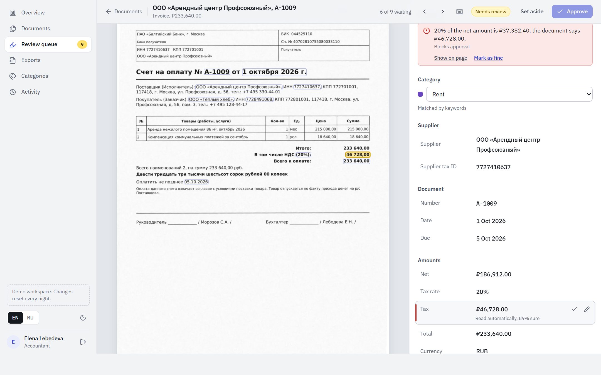
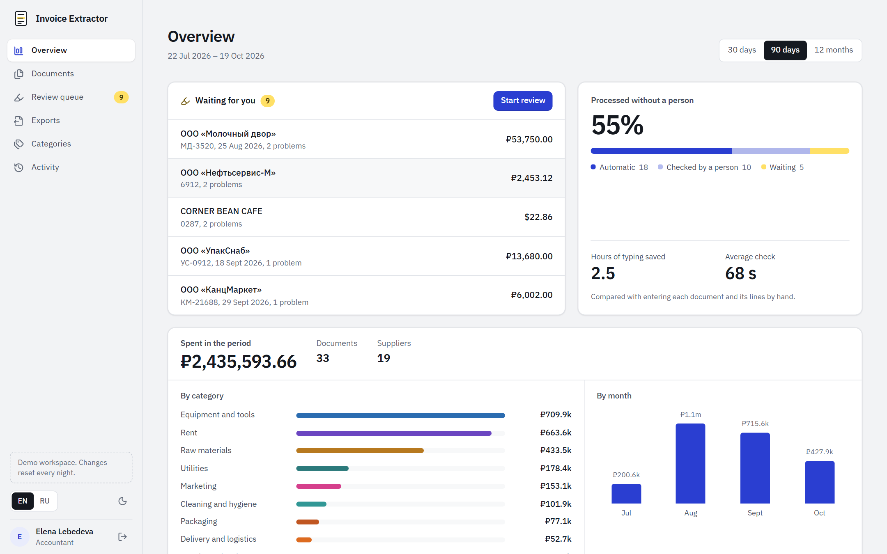
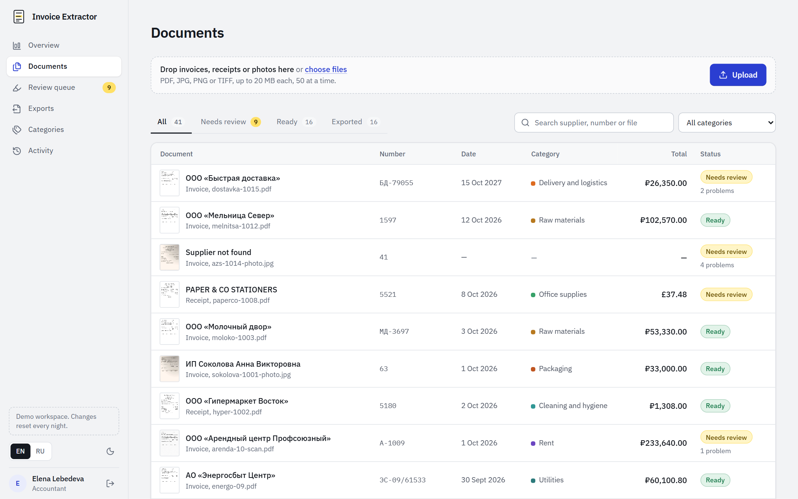
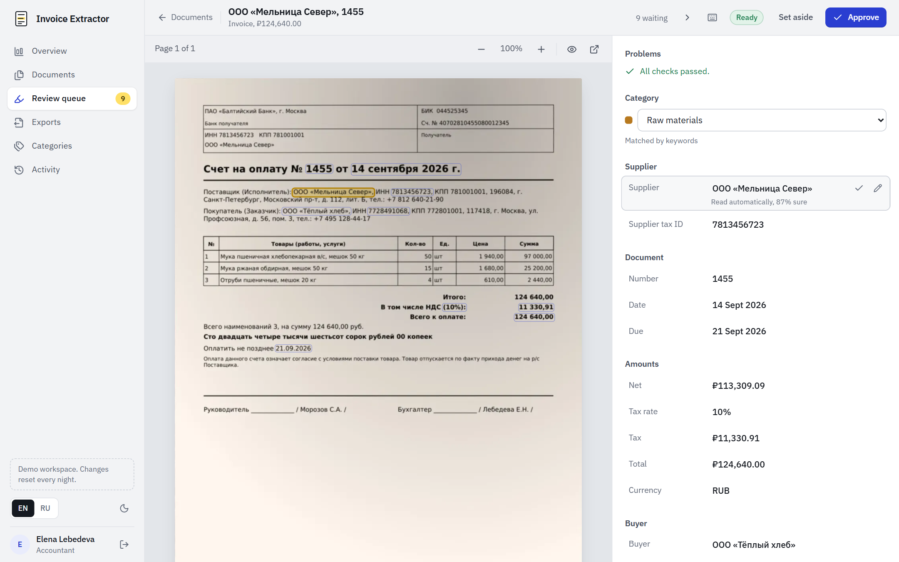
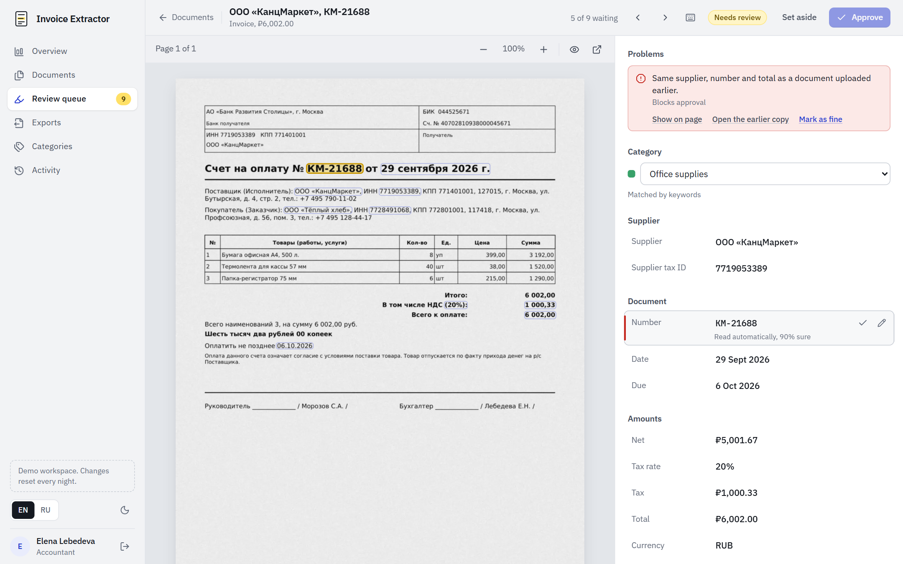
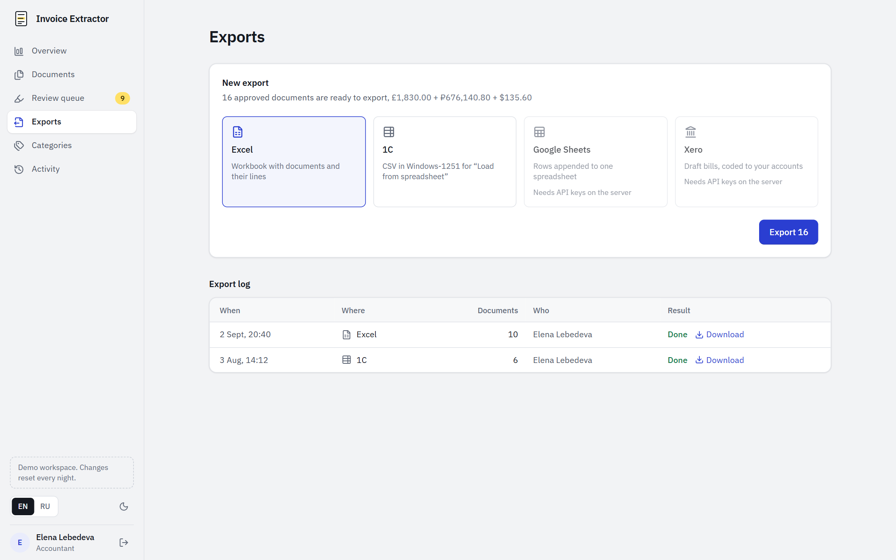
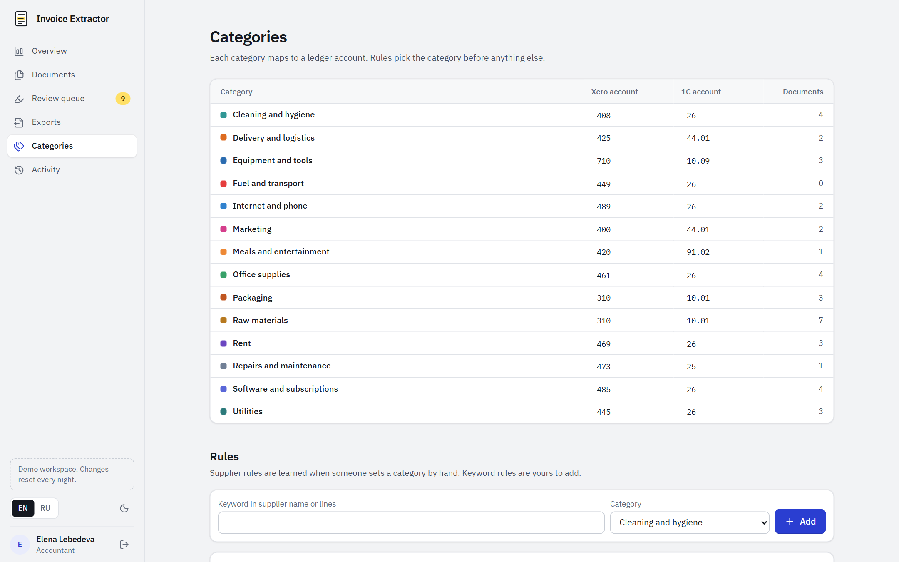
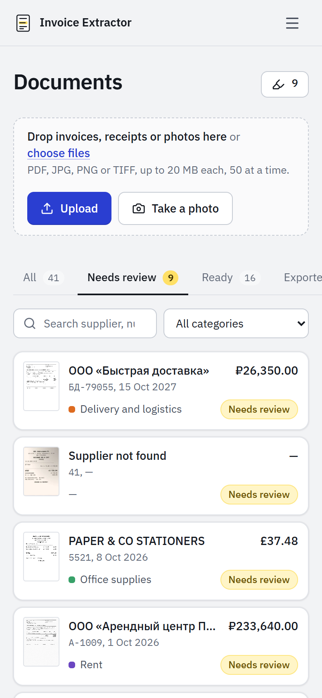
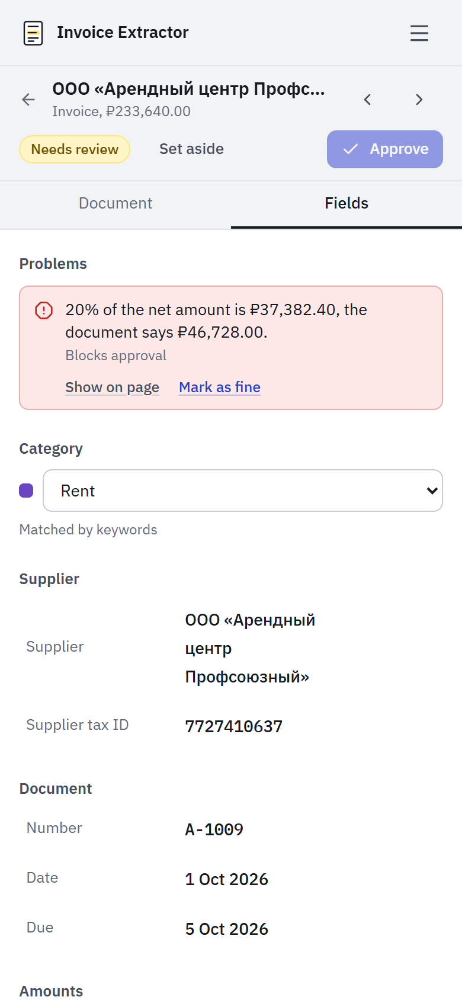
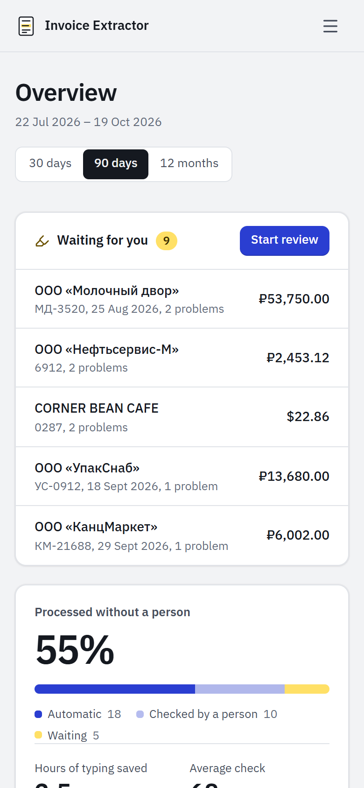

# Invoice Extractor

Reads invoices, receipts, waybills and acts (PDFs, scans, phone photos), checks the numbers and exports them to Excel, 1C, Google Sheets or Xero. Anything the checks are not sure about goes to a review queue where the doubtful value is marked right on the page.

It is built for small-business bookkeeping: a bakery, a studio, an agency that gets a few hundred supplier documents a month in Russian and English and still types them in by hand.

**Live demo: https://invoices.narcisbin.com** (one-click sign-in as the owner or the accountant, 41 sample documents loaded, the data resets every night). Files you upload there are read by a language model with a daily token cap; the samples are read by the layout rules.



## What it does

- Documents come in by drag and drop, from the phone camera, from a mailbox you forward invoices to (IMAP), or through the API.
- Text-layer PDFs are read directly. Scans and photos are straightened (perspective, skew, shadows), cleaned of table borders and passed through Tesseract in Russian and English. Fields are then extracted either by layout rules, which work offline, or by any OpenAI-compatible model with a strict JSON schema.
- Checks run on every document: net plus tax equals the total, lines add up, VAT matches the stated rate, the INN check digit is valid, the date is not in the future, the document is not a second copy of one already uploaded, the amount is not three times what this supplier usually bills. Every field also carries its own confidence.
- Documents that pass every check with confident key fields go straight through. The rest wait in the review queue: document on the left, fields on the right, the selected value highlighted on the page. Fix a value by typing or by clicking a word on the scan. `J`/`K` move between fields, `Enter` confirms, `E` edits, `Ctrl+Enter` approves.
- Categories come from supplier rules first, then keyword rules, then the model's suggestion. When someone sets a category by hand, the next document from that supplier gets it automatically.
- Exports go to an Excel workbook with documents and lines, a CSV for 1C (Windows-1251, semicolons, decimal commas), rows appended to a Google spreadsheet, or draft bills in Xero coded to the right accounts. Every export is logged.
- The overview shows spend by category, month and supplier, the share of documents processed without a person and the hours of typing saved.

Two roles: the owner manages integrations and API tokens, the accountant uploads, reviews and exports. Every change is written to an activity log.

| | |
|---|---|
|  |  |
|  |  |
|  |  |

<p>
  
  
  
</p>

## How well it reads

The repository ships 41 generated sample documents in `database/demo`: Russian invoices, waybills, acts and till receipts, English invoices from UK, German and US suppliers, as clean PDFs, noisy scans and photos taken at an angle. Some contain deliberate mistakes (a wrong VAT line, a broken INN, a duplicate, a date in 2027). `worker/demo/evaluate.py` compares what the worker reads with what was printed.

Layout rules engine, no language model:

| Documents | Fields read correctly |
|---|---|
| Clean PDFs (25) | 100% |
| Scans (8) | 98.6% |
| Phone photos (7) | 95.2% |
| Blurred phone photo (1) | 11% (goes to review, as it should) |
| All 41, all fields | 96.7% |

A text PDF takes about 0.3 s, a scan or photo 2 to 9 s on one CPU core. The documents are synthetic, so treat this as a regression check rather than a benchmark: real-world layouts vary more, which is what the language model engine and the review queue are for.

## Stack

| Part | Technology |
|---|---|
| Backend | PHP 8.4, Laravel 13, Horizon queues, Sanctum API tokens, spatie/laravel-permission, PhpSpreadsheet |
| Frontend | Vue 3.5, Inertia 3, TypeScript (strict), Tailwind CSS 4, Vite |
| Document reader | Python 3.12, FastAPI, PyMuPDF, OpenCV, Tesseract 5, httpx |
| Data | PostgreSQL 17, Redis |
| Runtime | Docker Compose, FrankenPHP |
| Quality | Pest, Larastan level 7, Pint, pytest, mypy (strict), Ruff, Vitest, ESLint, GitHub Actions |

## Run it

You need Docker with Compose.

```bash
git clone https://github.com/manch1915/invoice-extractor.git
cd invoice-extractor
cp .env.example .env
```

Fill in `APP_KEY` (`echo "base64:$(openssl rand -base64 32)"` prints one), `DB_PASSWORD` and `WORKER_TOKEN`. Set `DEMO_MODE=true` to get one-click demo sign-in and the sample documents. Then:

```bash
docker compose up -d --build
```

Open http://localhost:8080. With demo mode on, the 41 sample documents are read in the background right after the first start (about a minute on a laptop); the review queue fills up as they come in.

To use a language model instead of the layout rules, set `LLM_BASE_URL`, `LLM_API_KEY` and `LLM_MODEL` (any OpenAI-compatible endpoint). `LLM_DAILY_TOKEN_LIMIT` caps spending: tokens are booked before each call, and when the day's allowance runs out the worker falls back to the rules engine.

Google Sheets and Xero need OAuth apps of your own; the redirect URIs are listed in `.env.example`. The Xero app asks for the granular `accounting.invoices` scope that apps created after March 2026 require.

### Development without Docker

```bash
composer install && npm install
cp .env.example .env   # then set DB_CONNECTION=sqlite, QUEUE_CONNECTION=database, CACHE_STORE=file, SESSION_DRIVER=file
php artisan key:generate && php artisan migrate --seed
npm run dev & php artisan serve & php artisan queue:work --queue=extraction,exports,default

cd worker && uv sync && uv run uvicorn invoice_worker.main:app --port 8001
```

Text PDFs work without Tesseract; scans and photos need `tesseract` with the `rus` and `eng` language packs on the PATH, or the worker container. `php artisan demo:seed` loads the sample set through the running worker.

## How it is built

The Laravel app owns the business: documents, vendors, categories, checks, review, exports and the audit log. The checks live in `app/Domain/Validation` as plain classes that take a `DocumentFacts` value and return issues, so they are tested without a database and run the same way whichever engine read the document. Services in `app/Services` apply the worker's result, match vendors (tax id first, never rewriting an existing vendor from an unchecked document), pick categories and drive the review. Controllers only validate input and call a service. Amounts are stored as integers in kopecks or cents.

The Python worker is stateless: it takes a file and returns page images, every word with its position, the fields with a confidence and a box on the page, and the line items. Both engines (layout rules and the language model) return the same shape; for model answers the worker finds each value on the page itself, so a value the model made up has no box and low confidence. Laravel calls the worker from a queued job, stores the pages, re-runs the checks after every edit and decides whether a person has to look.

```
browser (Vue + Inertia) ──▶ Laravel ──HTTP──▶ worker (FastAPI, Tesseract, LLM)
                              │   ▲                  │
                    Horizon jobs   └── fields, boxes, pages
                              │
                     PostgreSQL, Redis, files
```

```
app/Domain        checks, money in minor units, tax id validation
app/Services      ingest, apply results, review, categories, exports, dashboard
app/Infrastructure worker client, Google Sheets and Xero clients
resources/js      pages, review workbench, i18n (English and Russian)
worker/src        page loading, image clean-up, OCR, rules and LLM engines
worker/demo       sample document generator and accuracy script
database/demo     the 41 generated sample documents and their expected values
```

## API

Create a token in Settings, then:

```bash
curl -H "Authorization: Bearer $TOKEN" -F "files[]=@invoice.pdf" http://localhost:8080/api/documents
# 202 {"data":[{"id":"01K...","status":"queued","url":"http://localhost:8080/api/documents/01K..."}]}

curl -H "Authorization: Bearer $TOKEN" http://localhost:8080/api/documents/01K...
```

The result lists every field with its value, confidence and whether a person checked it, plus line items, open issues and a link to the review screen.

## Tests

```bash
vendor/bin/pest                         # 84 tests, SQLite locally, PostgreSQL in CI
vendor/bin/phpstan analyse
npm test && npm run typecheck && npm run lint
cd worker && uv run pytest && uv run mypy && uv run python demo/evaluate.py ../database/demo --only-text
```

## По-русски

Сервис для бухгалтерии малого бизнеса. Загружаете пачку счетов, накладных, актов и чеков (PDF, сканы, фото с телефона, письма с вложениями), он достаёт поставщика, ИНН или VAT, номер, даты, позиции, суммы и НДС, сверяет итоги, ставку налога, контрольную сумму ИНН и дубликаты, раскладывает по категориям и выгружает в Excel, CSV для 1С, Google Таблицы или Xero. Всё сомнительное попадает в очередь проверки: документ слева, поля справа, нужное место подсвечено на скане, исправление в один клик. Интерфейс на русском и английском.

Демо: https://invoices.narcisbin.com (вход в один клик, 41 документ уже загружен, данные сбрасываются каждую ночь).

Запуск: `cp .env.example .env`, заполнить `APP_KEY`, `DB_PASSWORD`, `WORKER_TOKEN`, при желании `DEMO_MODE=true`, затем `docker compose up -d --build`.

## License

MIT
